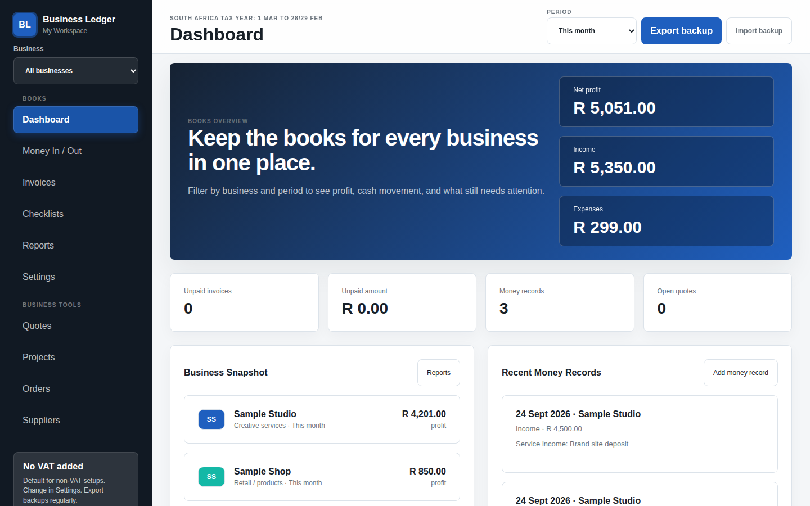
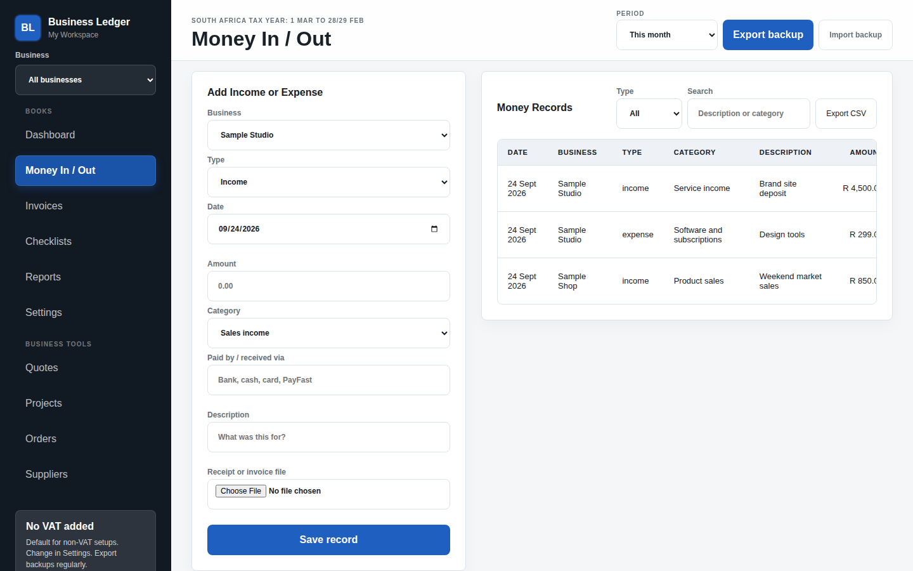
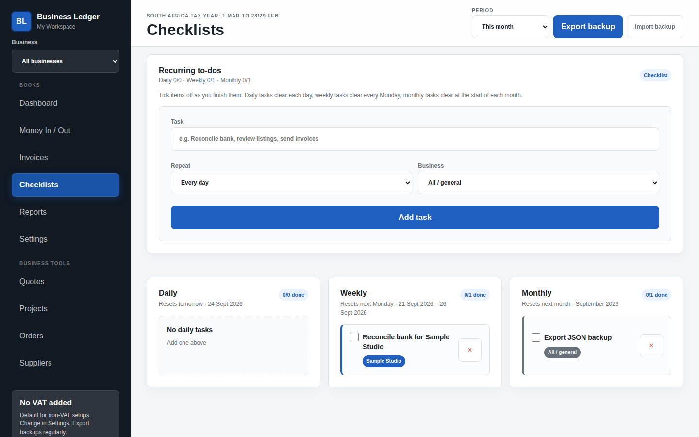
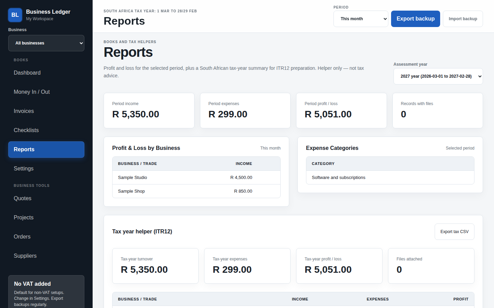

# Business Ledger

A privacy-first, offline bookkeeping app for people who run **more than one small business**. Plain HTML, CSS and JavaScript — no framework, no build step, no backend. All data lives in the browser (`localStorage`) with JSON backup/restore.

> Built and shipped as a real one-time-purchase product for South African freelancers and side-hustlers. Tax-year helpers follow the SA year (1 Mar – 28/29 Feb).

<!-- Screenshots: replace or add a short GIF/demo link here -->
| Dashboard | Money in / out |
|---|---|
|  |  |
| **Checklists** | **Reports** |
|  |  |

_Demo GIF / live demo link: **TODO**_

## Features

- **Multi-business books** — separate income/expenses per business, with per-business colour and logo
- **Money in / out** with optional receipt attachments and input validation
- **Invoices and quotes** (quotes convert to invoices)
- **Recurring checklists** (daily / weekly / monthly)
- **Reports** — profit & loss, period filters (this month, last month, SA tax year, all time), tax-year helper
- **Optional modules** — orders, suppliers, project pipeline, digital listings tab
- **Data safety** — CSV export, full JSON backup/import with schema validation, backup reminders, recovery from corrupt storage
- **First-run wizard**, accessibility basics (skip link, focus management, `aria-modal`)

## Tech stack

| Area | Choice |
|---|---|
| UI | Vanilla HTML / CSS / JavaScript (single page, hash routing) |
| Storage | Browser `localStorage` + JSON export/import |
| Tests | Playwright end-to-end scripts (Node ES modules) |
| Hosting | Static files — works from `file://` or any static server |

## Run it

No install required:

```bash
git clone https://github.com/tiabrittanypower/business-ledger-portfolio.git
cd business-ledger-portfolio
# either open index.html in Chrome/Edge, or serve the folder:
python3 -m http.server 8080   # then visit http://localhost:8080
```

Complete the setup wizard (workspace name, currency, VAT flag, first business). Use **Settings → Load sample data** to explore with demo content.

### Tests

```bash
npm install --no-save playwright   # first time only
npx playwright install chromium
node tests/smoke-ready.mjs
node tests/test-export-backup.mjs
node tests/test-listings-toggle.mjs
node tests/test-todos.mjs
```

Set `PLAYWRIGHT_PATH` if Playwright is installed somewhere non-standard.

## Project structure

```
index.html, app.js, styles.css   The app
assets/                          Icon
landing/                         Marketing landing page
tests/                           Playwright tests
backups/                         Sample/empty backup fixture (real backups are git-ignored)
docs/
  BUYER-GUIDE.md                 End-user guide: backup, updating, scope
  MAINTAINER-NOTES.md            Project rules
  design/                        Wireframe, mockup, brand/CI PDFs
  marketing/                     Go-to-market plan, listing copy, brand kit, screenshots
CHANGELOG.md, LICENSE.txt
```

## Limitations

Not a hosted/multi-user product, no bank feeds, and not tax advice. Single-browser storage means backups matter — see the [buyer guide](docs/BUYER-GUIDE.md).

## Licence

Proprietary — see [LICENSE.txt](LICENSE.txt). Source is public for portfolio review only.
